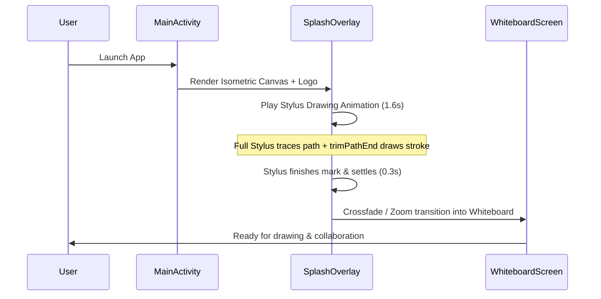

# Design Spec: CreaVITy App Logo, Adaptive Icons, and Animated Stylus Splash Screen

## 1. Overview & Context

CreaVITy is an offline collaborative digital whiteboard for Android built with Jetpack Compose, Material 3 Expressive, and Google Jetpack Ink. This design delivers:
1. An iconic, distinctive **app logo** featuring the user's custom continuous cursive `cr` monogram drawn on an authentic **whiteboard canvas with isometric dots**, terminated with an enlarged stylus nib clipped cleanly by the squircle boundary.
2. Complete **Android Adaptive Icons** (`ic_launcher`, `ic_launcher_round`, and Android 13+ themed `monochrome` icon).
3. A sleek native **Animated Vector Drawable (AVD)** and an interactive **App Splash Screen** where a **full digital stylus** actively draws the `cr` logo onto the isometric canvas before seamlessly transitioning into the main collaborative whiteboard workspace.

---

## 2. Visual Architecture & Geometry

### 2.1 The Master Canvas & Squircle
- **Viewport**: 512 x 512 (Vector reference) / 108dp x 108dp (Android Adaptive Icon reference).
- **Background**:
  - Architectural drafting canvas base (`#F7F8FA`).
  - **Isometric Dot Grid**: Triangular isometric lattice with spacing `48dp` (row height $\frac{\sqrt{3}}{2} \times \text{spacing}$ with alternate row half-spacing offset), matching `com.kd.creavity.presentation.canvas.BackgroundDrawer.kt`.
  - Dot color: `#CBD2DC` (subtle, tactile drafting dots).
  - Squircle base radius: `rx="96"` (Material 3 Expressive superellipse profile) with a hairline top-bevel light highlight (`#FFFFFF` 40% to `#000000` 10%).

### 2.2 The 'cr' Monogram Glyph
- **Path**: Based on the user's custom-refined single continuous Bézier curve:
  - Starts at upper-right of `c`, swoops around the smooth left belly.
  - Optical padding: Shifted and scaled so the left curve of `c` maintains standard safe-zone margin (18% from squircle left border).
  - Bridges into `r` with balanced dual curl loops.
  - Grounds on the baseline and sweeps up toward the right edge.
- **Stroke**:
  - Color: Deep Obsidian Ink (`#151922`), providing high contrast on the canvas.
  - Width: Scaled proportionally (~24dp in master, 4.5dp in launcher icon).
  - End caps: Rounded (`strokeLineCap="round"`).

### 2.3 Stylus Nib & Squircle Clipping
- **Static Icon Nib**:
  - Enlarged bold conical nib (triangle cone with rounded drawing tip).
  - Fused seamlessly at the end of the stroke.
  - Sits flush at the right edge and is clipped cleanly by the squircle perimeter (`clip-path`).
- **Full Stylus for Splash Drawing Animation**:
  - Sleek digital whiteboard stylus:
    - Ergonomic barrel body with minimal accent grip ring.
    - Conical nose cone.
    - Precision elastomer nib tip touching the drawing point.
  - Animates along the path trajectory, rotating to follow the curve's instantaneous tangent.

---

## 3. Android Splash Screen & Animation Architecture

### 3.1 Flow & Lifecycle

### 3.2 Animation Mechanics
1. **Stroke Animation**:
   - `ObjectAnimator` animating `trimPathEnd` from `0.0f` to `1.0f` over `1600ms`.
   - Interpolator: `FastOutSlowInInterpolator` (`@android:interpolator/fast_out_slow_in`) for organic drawing speed acceleration and deceleration.
2. **Stylus Motion Tracking**:
   - Stylus group animated along the path using `android:propertyXName="translateX"` and `android:propertyYName="translateY"` following the path data.
   - Rotation synchronized with tangent angle.
3. **App Transition Gate**:
   - `onAnimationEnd` (or user tap to skip) triggers a smooth alpha fade (`300ms`) revealing the main whiteboard canvas.

---

## 4. Resource File Layout

- `app/src/main/res/drawable/ic_launcher_background.xml` (Isometric dot grid canvas)
- `app/src/main/res/drawable/ic_launcher_foreground.xml` (Clipped `cr` + enlarged nib)
- `app/src/main/res/drawable/ic_launcher_monochrome.xml` (Themed monochrome icon)
- `app/src/main/res/mipmap-anydpi-v26/ic_launcher.xml`
- `app/src/main/res/mipmap-anydpi-v26/ic_launcher_round.xml`
- `app/src/main/res/drawable/avd_creavity_splash.xml` (AnimatedVectorDrawable)
- `app/src/main/res/animator/anim_logo_draw.xml`
- `app/src/main/res/animator/anim_stylus_track.xml`
- `app/src/androidMain/kotlin/com/kd/creavity/presentation/ui/components/SplashDrawingOverlay.kt` (Compose splash transition wrapper)

---

## 5. Verification & Testing Plan
1. **Vector Rendering**: Export and verify SVG/PNG at multiple densities (108dp, 512px).
2. **Icon Shape Audit**: Verify squircle clipping on circle, rounded square, and teardrop Android launchers.
3. **AVD Animation Test**: Verify `trimPathEnd` and stylus tracking run at 60/120fps without jank or CPU spikes.
4. **App Launch & Skip**: Test fresh app launch, ensuring smooth transition to whiteboard, and test tap-to-skip responsiveness.
